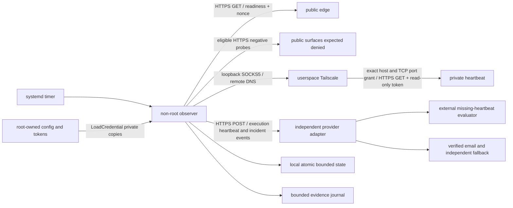

# Design and hosting boundary

## Intended placement

Use an independently hosted **unprivileged Debian LXC**, initially sized at 1 vCPU,
512 MiB RAM and 4–8 GiB local storage. This is a capacity estimate to verify, not a
benchmark. The external host and its owner are deployment inputs. There is no
Terraform state, Proxmox API credential, SSH automation, provider purchase, or
live guest provisioning in this repository.

The observer needs no Docker, nested containers, host filesystem mount, TUN
device, raw socket, kernel module, elevated Linux capability, privileged LXC, or
public inbound listener. Guest administration can use the hosting operator's
Proxmox console. Inventory and firewall policy belong to that host's IaC, not
to hardcoded values in this public source.

Tailscale is optional and is a separate userspace daemon with a **loopback-only**
SOCKS5 listener. That is the sole intentional local proxy listener. The observer
source opens no listener. The supplied unit requests IPv4/IPv6 bind denial with
`SocketBindDeny=any`; its actual enforcement on the guest must be verified, and
it does not cover AF_UNIX. The service cannot install the daemon or modify its
enrollment or tailnet policy.

## Data flow

No edge/private response body is persisted, journaled or forwarded. Provider
events carry observer ID, fixed incident key, incident/recovery type, event ID
and UTC timestamp. The journal carries fixed response classes, latency, outcomes,
incident flags, clock trust, provider acknowledgment and aggregate spool counts.
The private queue's rows, metrics, raw alerts, tokens and arbitrary extra fields
are rejected. The provider receives no home URL, nonce, queue count or alert body.

## Probe behavior

All target requests use HTTPS with the OS trust store, TLS 1.2 or newer, exact SNI
and hostname verification. A DNS hostname is required; address literals, URL
credentials, fragments, query strings and raw control characters are rejected.
Redirects are never followed. Environment proxy variables are ignored. Public
probes use the guest's resolver and direct public connection, so the guest must
not use a home split-horizon/wildcard resolver. Private probes always send a
SOCKS5 DOMAINNAME request to `127.0.0.1:<socks_port>`; destination DNS stays in
the Tailscale userspace proxy. There is no direct private fallback on proxy loss.

Readiness requires HTTP 200 and the exact configured JSON object, including
value types. A separate freshness canary must echo a generated 128-bit nonce
and a UTC timestamp no more than 120 seconds before/after the observer's
trusted clock, with `Cache-Control: no-store`. Readiness alone is insufficient.
Private heartbeat freshness has the same requirements plus a closed schema,
bounded nonnegative counts, `queue.ready=true`, and a configured queue-age ceiling.

Negative checks run only after both same-cycle public readiness and freshness
pass. They require verified TLS followed by the exact configured 4xx denial,
post-TLS EOF, or post-TLS reset with **no HTTP response bytes**. Received HTTP
bytes followed by truncation/abort are inconclusive, never expected denial.
A successful TCP connect, TLS error, pre-TLS
reset, DNS error or timeout never proves denial. Unexpected verified-TLS HTTP
or the wrong configured post-handshake abort fails the exposure check. A malformed
verified-TLS response is inconclusive. An
inconclusive transport failure preserves the exposure streak; it does not page
as a new exposure incident. Negative response bodies are not read.

The workers accept response bodies no larger than 16 KiB with bounded overflow
detection, cumulative headers at 16 KiB, each header line at 8 KiB, each probe
lifetime at 8 seconds, and the negative list at eight endpoints. Duplicate JSON keys,
duplicate HTTP headers, malformed HTTP/1.x status/header syntax, ambiguous or
unsupported framing, incomplete bodies/trailers, non-finite JSON values and
compressed bodies are refused. An `http_denial` also requires complete valid
headers before its configured status can count; its response body is not read.
Health JSON accepts only bounded decimal content lengths and strict chunk framing:
1–8 ASCII hexadecimal size digits, CRLF delimiters, final zero chunk, with no
chunk extensions or trailer fields.
All child processes are killed/reaped at their group deadline, including blocked
DNS and slow-drip responses. Only the observer parent touches persistent state.

## Incident state and liveness

Each machine opens after three consecutive failures and recovers after two
passes. WAN, exposure and private machines are independent. Clock and provider
path have their own local machines. Inconclusive exposure cycles retain existing
streaks and incidents. A WAN outage suppresses negative evaluation for that cycle.
An exact eligible denial resets its exposure failure streak. Home recovery needs
both its passing probe streak and an acknowledged provider heartbeat in that
cycle. Provider failure cannot erase a home incident.

The observer submits an execution heartbeat first, even when home checks fail.
Its accepted receipt shows only that this pre-probe stage was reached; it does
not establish probe, state, or event-delivery completion. The external provider
must evaluate **its receive time**, opening an observer/provider-path-loss
incident after three missed 30-second heartbeats. Heartbeats are never spooled
or replayed: old execution must not masquerade as current liveness. The local
`provider_path` incident can be queued, but cannot alert through a failed
provider. It reflects `heartbeat_url` only; an isolated `events_url` failure can
leave it healthy while retained events retry. External `observer_host` evaluation
lives outside this process and is a mandatory deployment gate.

Event delivery is at least once while retained: an acknowledged event can replay
after a crash before the next atomic write, so the adapter must deduplicate the
stable event ID for at least 24 hours. Retries use 5, 10, 20…300-second delays;
30-second timer cadence means the first actual retry may be later than 5 seconds.
The oldest retained pending event blocks later retained events to preserve their
queue order. Open incidents receive a fresh reminder after 24 hours. Events expire
after 24 hours and the spool is capped at 1,000 events / 16 MiB; oldest events are
dropped to remain bounded and the evidence contains a capped drop counter. An
undelivered incident can therefore expire before a later recovery: delivery and
incident/recovery order are not global guarantees after expiry or dropping. This
is bounded best-effort alerting, not a lossless message queue. The external
dead-man is the control for a prolonged provider or observer failure.

## Runtime permissions and durability

The code and systemd units are root-owned and read-only to `offsite-observer`.
Production config and token source files are root-owned 0600 under a root-only
directory. The supplied systemd unit's `LoadCredential` directives provide
private, service-readable copies; secrets are not placed in argv, environment
values, logs, unit names or config fields. Only the credential-directory **path**
is in the environment. Live runtime rejects root and checks that its config path
matches `CREDENTIALS_DIRECTORY/config` plus the private copies' file safety and
fixed token names. Those checks do not authenticate systemd as the credential
issuer, so manual live execution is outside the unit's credential, sandbox,
deadline and resource-control boundary.

State is **service-owned 0600** under a service-owned 0700 local directory. This
is a deliberate least-privilege choice: requiring a root-owned writable state
file would conflict with a non-root runtime. State is not independently trusted
against compromise of the observer account. A compromised runtime can forge its
own state/probes/heartbeats, steal its narrow tokens and flood its adapter; it
cannot legitimately acquire broad LAN access, host privileges, remediation
access or private data export. External policy and rate limits must contain it.

An advisory `flock` refuses overlapping manual/timer runs. A fixed mode-0600
`.state.pending` slot is validated before reuse, fsynced, atomically renamed and
the directory fsynced. At most one interrupted slot survives a crash, so repeated
SIGKILLs cannot accumulate temporary files; state plus pending uses at most 32 MiB.
Use an external guest disk quota/free-space alert as the filesystem backstop.
Corrupt, oversized, symlinked, hardlinked or unsafe-permission state fails closed instead of resetting
and silently forgetting incidents. The parent saves newly created events before
sending, and saves delivery changes afterward.

The timer starts every 30 seconds while enabled. Work is scheduled inside a
19-second monotonic deadline, reserving one second within the service's hard
`TimeoutStartSec=20s`; `KillMode=control-group` also kills workers if storage or
the parent stalls. Unit-level timeouts and resource controls need real guest
acceptance. The unit caps memory at 256 MiB, CPU at 50% of one core, tasks at 32
and file descriptors at 128. The LXC allocation is separate. Journal retention
is seven days / 64 MiB maximum, so pressure can remove evidence sooner.

Clock trust requires `timedatectl show -p NTPSynchronized --value` to report
`yes`; failure/unknown is unhealthy, not an override. Freshness and private
checks fail closed when the clock is untrusted, and a separate clock incident
opens after three failures. An LXC shares the host kernel clock; the host must
be synchronized and the guest must demonstrably report trust. Do not grant
clock-setting capability to solve an untrusted result. NTP trust does not
cryptographically prove UTC or defend against a compromised host. State loading
refuses `created`/`notified` values more than 300 seconds ahead of the cycle
clock, or retry `next` more than 600 seconds ahead to allow a 300-second retry
after the bounded rollback, before it sends a heartbeat.
A backward step beyond that tolerance can therefore stop the observer until the
clock is reconciled. After a successful state load, spool bounding retains events
created up to 300 seconds in the future and drops older/extreme entries. The
external provider's independent receive-time dead-man remains mandatory.

## Primary references used

- [Tailscale userspace networking](https://tailscale.com/docs/concepts/userspace-networking)
  describes its proxy mode without a TUN device.
- [Tailscale unprivileged LXC](https://tailscale.com/docs/features/containers/lxc/lxc-unprivileged)
  documents LXC considerations; this design selects userspace to avoid host device changes.
- [SOCKS5 RFC 1928](https://datatracker.ietf.org/doc/html/rfc1928)
  defines the domain-name CONNECT request.
- [Python 3.11 TLS documentation](https://docs.python.org/3.11/library/ssl.html)
  describes default certificate and hostname verification.
- [systemd 252 execution documentation source](https://github.com/systemd/systemd/blob/v252/man/systemd.exec.xml)
  defines sandboxing, credentials and directory ownership.
- [systemd 252 timer documentation source](https://github.com/systemd/systemd/blob/v252/man/systemd.timer.xml)
  defines timer cadence and active-unit behavior.
